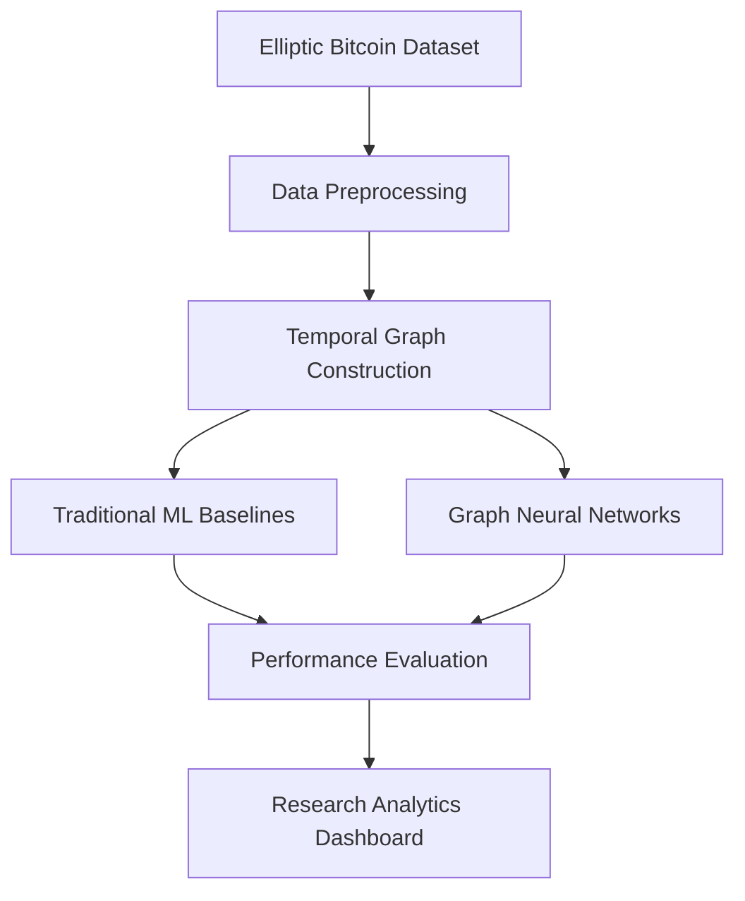
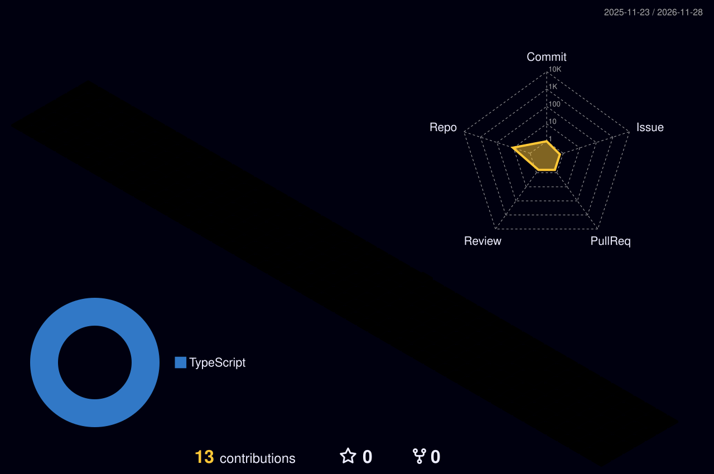
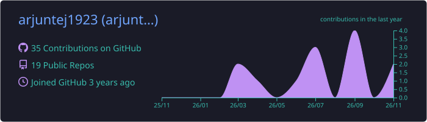
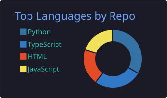
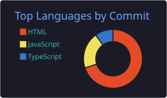
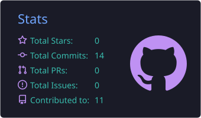
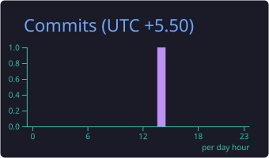

<div align="center">


[](https://git.io/typing-svg)


</div>

---

## 👨‍💻 About Me

I am a Computer Science Engineering undergraduate at Lovely Professional University, passionate about designing scalable, intelligent and impactful technology solutions.

My work combines software engineering, artificial intelligence, cloud computing and full-stack development to address real-world challenges.

```yaml
name: M. Arjun Tej
education: B.Tech Computer Science Engineering
university: Lovely Professional University
graduation: 2028
location: India

interests:
  - Full Stack Development
  - Artificial Intelligence
  - Graph Machine Learning
  - Cloud Computing
  - DevOps and Networking
  - Open Source

currently_working_on:
  - GraphShield Research
  - Scalable Web Applications
  - Cloud Native Technologies

open_to:
  - Software Engineering Internships
  - Research Internships
  - Technical Collaborations
  - Open Source Contributions
```

---

## 🎓 Education

| Qualification | Institution | Duration |
|---|---|---|
| B.Tech — Computer Science Engineering | Lovely Professional University | Expected 2028 |
| Diploma — Computer Science Engineering | Lovely Professional University | 2022–2025 |

---

## ⚡ Technology Stack

### Programming Languages

<p align="center">

</p>

### Frontend Development

<p align="center">

</p>

### Backend Development

<p align="center">

</p>

### Databases

<p align="center">

</p>

### Artificial Intelligence & Machine Learning

<p align="center">

</p>

### Cloud Computing & DevOps

<p align="center">

</p>

### Development & Design Tools

<p align="center">

</p>

---

## 🚀 Featured Projects

| Project | Description | Domain |
|---|---|---|
| [GraphShield](https://github.com/arjuntej1923/GraphShield) | Graph-based coordinated financial fraud detection research | AI / ML |
| [Rail Madad AI](https://github.com/arjuntej1923/Rail-Madad-AI) | Intelligent railway complaint management platform | Full Stack / AI |
| [AttendWise LPU](https://github.com/arjuntej1923/AttendWise-LPU) | Smart attendance calculation and academic planning | EdTech |
| LPU GPA Calculator | CGPA and TGPA estimation platform | EdTech |
| Bharath Infra AI | Infrastructure monitoring and civic management | CivicTech |
| NivAaran | Intelligent banking complaint management concept | FinTech |
| Banking Network Topology | Enterprise network simulation using Cisco Packet Tracer | Networking |
| Personal Expense Manager | Python-based financial management application | Python |
| CampusLeave | Cloud-based student leave management system | AWS |
| Real-Time Process Monitor | Operating system resource monitoring dashboard | Systems |

### Featured Repository Cards

<div align="center">

<a href="https://github.com/arjuntej1923/GraphShield">

</a>

<a href="https://github.com/arjuntej1923/Rail-Madad-AI">

</a>

<a href="https://github.com/arjuntej1923/AttendWise-LPU">

</a>

</div>

---

## 🔬 Research Spotlight — GraphShield

### Graph Neural Networks for Coordinated Online Fraud Detection

GraphShield is a research-oriented project exploring graph-based machine learning techniques for identifying suspicious and coordinated financial transaction patterns.

| Dataset Information | Value |
|---|---:|
| Dataset | Elliptic Bitcoin |
| Transactions | 203,769 |
| Graph Edges | 234,355 |
| Transaction Features | 165 |
| Temporal Steps | 49 |
| Labelled Transactions | 46,564 |

### Research Methodology

- Temporal graph analysis
- Financial transaction classification
- Traditional machine learning baselines
- Logistic Regression, Random Forest and XGBoost
- Graph Neural Network exploration
- Feature importance and explainability
- Interactive research analytics dashboard

### Research Architecture



[Explore GraphShield Research](https://github.com/arjuntej1923/GraphShield)

---

## 🏆 Achievements

### National Hackathon — Third Prize

- Pushpa Gujral Science City, Kapurthala
- March 2025
- Project: Rail Madad AI Complaint Management System

### District Badminton Championship

- Championship Winner
- September 2019

---

## 📜 Certifications & Industrial Training

| Certification | Organization | Year |
|---|---|---|
| AWS Academy Graduate — Cloud Foundations | AWS Academy | 2026 |
| Python Basics to Advanced | eTechniketan | 2026 |
| CCNA: Cyber Security Fundamentals | O7 Services | 2024 |

---

## ☁️ Cloud & Infrastructure Experience

<div align="center">


</div>

- Amazon EC2, S3, RDS and Lambda
- CloudFront and Route 53
- API Gateway, DynamoDB, Cognito and SNS
- Google Cloud Platform
- Docker containerization
- Kubernetes and Minikube
- Cisco enterprise networking

---

## 📊 GitHub Statistics

<div align="center">


</div>

---

## 📈 Contribution Activity

[](https://github.com/arjuntej1923)

---

## 🐍 Contribution Snake

<div align="center">

<picture>
  <source media="(prefers-color-scheme: dark)" srcset="https://raw.githubusercontent.com/arjuntej1923/arjuntej1923/output/github-snake-dark.svg">
  <source media="(prefers-color-scheme: light)" srcset="https://raw.githubusercontent.com/arjuntej1923/arjuntej1923/output/github-snake.svg">
  
</picture>

</div>

---

## 🌐 3D Contribution Calendar

<div align="center">



</div>

---

## 📊 Advanced Developer Analytics

<div align="center">









</div>

---

## 🎯 Current Focus

- Graph Neural Networks and Applied Machine Learning
- Data Structures and Algorithms
- Scalable Full Stack Development
- Cloud Native Architecture
- Software Engineering
- Open Source Contributions
- Research and Innovation

---

## 🤝 Connect With Me

<div align="center">

[](https://github.com/arjuntej1923)

### Open to Internships, Research and Collaborations

</div>

---

<div align="center">

### Developer by passion. Innovator by purpose.

**Build. Learn. Research. Innovate.**


</div>
